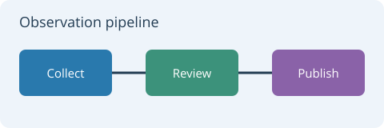

# Markdown FAST — Rendering Sample

This document covers CommonMark and GitHub-style Markdown.
Use `make` or `make run-sample` to rebuild the viewer and open it.

Compare Open Sans styles, light and dark themes, line wrapping, and scrolling.
The examples cover [GitHub Markdown](https://github.github.com/gfm/), plus alerts, details, footnotes, and other extensions.
Use [SAMPLE-HUGE.md](SAMPLE-HUGE.md) for the larger scrolling and layout test.
Use [SAMPLE-EXTENDED.md](SAMPLE-EXTENDED.md) for scripts and symbols that need system font fallback.

## GitHub-style preview

**Ready to read**, *easy to scan*, ~~old text~~, and `inline code`.

| Element | Example | Status |
| :--- | :---: | ---: |
| Rich text | **Bold**, *italic*, ~~deleted~~ | 3 |
| Links | [Jump to tables](#tables) | 1 |
| Escaped pipes | `left \| right` | 2 |

- [x] Render tables and inline styles.
- [ ] Try a narrow window and a larger font.

> [!TIP]
> Click a heading link to jump within the sample. Resize the window to check table wrapping.

## Contents

- [Headings](#headings)
- [Text styles](#text-styles)
- [Paragraphs and line breaks](#paragraphs-and-line-breaks)
- [Lists](#lists)
- [Block quotes](#block-quotes)
- [Links](#links)
- [Images](#images)
- [Code](#code)
- [Horizontal rules](#horizontal-rules)
- [Tables](#tables)
- [GitHub alerts](#github-alerts)
- [Collapsible sections](#collapsible-sections)
- [Extended syntax](#extended-syntax)
- [Unicode and symbols](#unicode-and-symbols)
- [Layout stress](#layout-stress)
- [End of document](#end-of-document)

## Headings

# Heading level 1

First-level text.

## Heading level 2

Second-level text.

### Heading level 3

Third-level text.

#### Heading level 4

Fourth-level text.

##### Heading level 5

Fifth-level text.

###### Heading level 6

Sixth-level text.

### A heading with optional closing hashes ###

Alternative first-level heading
===============================

This heading uses an underline instead of a leading hash.

Alternative second-level heading
--------------------------------

This heading uses the other underline style.

### A heading with **bold**, *italic*, and `inline code`

These styles also appear inside a heading.

## Text styles

This sentence uses regular text, **bold text**, *italic text*, and ***bold italic text***.

These alternatives use __underscores for bold__, _underscores for italic_, and ___both styles together___.

Inline code includes `sample.txt`, `font_size = 12`, and `./build/mdf SAMPLE.md`.

A code span can contain backticks: ``print(`hello`)``.

Strikethrough supports ~~removed words~~, ~~**removed bold text**~~, and ~~*removed italic text*~~.

Nested styles: **bold with _italic_ inside**, *italic with **bold** inside*, and **a `code` span inside bold**.

Escaped markers stay visible: \*asterisks\*, \_underscores\_, \#hashes, \[brackets\], and \`backticks\`.

Entities in prose: &amp; &lt; &gt; &quot; &apos; &copy; &reg; &trade; &mdash; &hellip; &#169; &#x2212;.

The same entities in code stay literal: `&amp; &lt; &gt; &#x2212;`.

**Font comparison:**

The quick brown fox jumps over the lazy dog. 0123456789.

**The quick brown fox jumps over the lazy dog. 0123456789.**

*The quick brown fox jumps over the lazy dog. 0123456789.*

***The quick brown fox jumps over the lazy dog. 0123456789.***

`The quick brown fox jumps over the lazy dog. 0123456789.`

## Paragraphs and line breaks

Blank lines separate paragraphs.

This is a second paragraph.

These two source lines belong to one paragraph.
An ordinary source newline is a soft line break.

This line ends with a backslash to request a hard line break.\
This line starts immediately after that break.

This line ends with two spaces to request the other hard-break syntax.  
This line also starts immediately after a break.

Resize the window to compare wrapping of **bold phrases**, *italic phrases*, and `small code spans`. Their different widths affect line breaks.

## Lists

### Unordered list

- A plain item.
- An item with **bold text** and *italic text*.
- An item with `inline code` and a [link to the README](README.md).
- A parent item.
  - A child item.
  - Another child item.
    - A third-level item.
    - Another third-level item.
- A final item at the original level.

### Other bullet markers

* An asterisk also creates a bullet.
* This is another item in the same list.

+ A plus sign also creates a bullet.
+ This is another item in the same list.

### Ordered list

1. Open the sample document.
2. Compare the heading sizes.
3. Compare the themes and font sizes.
   1. Select Classic (Open Sans 12).
   2. Select Paper (Open Sans 14).
   3. Select Terminal (Open Sans 11).
   4. Use the sun/moon button to switch light/dark mode independently.
4. Resize the window.

### Ordered list with a different start

7. This list starts at seven.
8. This item follows seven.
9. This item follows eight.

Parentheses also delimit ordered items:

1) First item.
2) Second item.

### List with paragraphs and a code block

- This item contains two paragraphs.

  This second paragraph remains inside the same item.

- This item contains a command:

  ```sh
  ./build/mdf SAMPLE.md
  ```

- This longer item wraps in a narrow window. Its continuation lines keep the same indentation as its first line.

## Block quotes

> A short quotation can occupy one line.

> This quotation contains **bold text**, *italic text*, and `inline code`.
>
> A second paragraph belongs to the same quotation.
>
> > This is a nested quotation.
> >
> > Its second paragraph remains at the deeper level.

> - A quotation can contain a list.
> - This is its second item.
>
> The final paragraph follows the list.

## Links

An inline link opens the [Zig website](https://ziglang.org).

A link can include a title: [CommonMark](https://commonmark.org "CommonMark specification").

These are **[a bold link](https://example.com)** and *[an italic link](https://example.com)*.

This paragraph uses a [reference-style link][project-readme] and a [collapsed reference][reference link].

Local links open the [README](README.md) and the [development plan](docs/mdf-todo.md).

An anchor jumps to [Code](#code), [Tables](#tables), or the [end of this document](#end-of-document).

Autolinks use angle brackets: <https://example.com/> and <reader@example.com>.

GitHub also links bare addresses: https://github.com, www.example.com, and reader@example.com.
Trailing punctuation stays outside the link (https://example.com/path).

A reference can use its label directly: [project-readme].

An [empty destination]() is valid link syntax.

## Code

### Zig

```zig
const std = @import("std");

pub fn main() void {
    const title = "Markdown FAST";
    const sizes = [_]u16{ 10, 12, 14, 16, 18, 24 };

    for (sizes) |size| {
        std.debug.print("{s}: font size {d}\n", .{ title, size });
    }
}
```

### JSON

```json
{
  "project": "Markdown FAST",
  "theme": "light",
  "font": "Open Sans",
  "font_size": 12,
  "auto_reload": true,
  "available_fonts": ["Open Sans"]
}
```

### Shell

```sh
make check-requirements
make run-sample
```

### Indented code

The next block uses four leading spaces instead of fences:

    first = "plain text"
    second = "    spaces stay visible"
    third = "**markers remain literal**"

A tab also creates an indented code block:

	text = "tab-indented code"

### Tilde and empty fences

~~~text
**Markdown markers** stay literal inside a tilde fence.
~~~

The following fenced block is empty:

```
```

### Diff

```diff
- const parser = CommonMark;
+ const parser = GitHubMarkdown;
  render(document);
```

### Fence markers inside code

````markdown
```text
A fence can appear inside a larger fenced block.
```
````

### A long code line

```text
sample_path = "/a/long/path/to/a/markdown/document/with/several/subdirectories/and/a_filename_that_keeps_going_to_show_how_the_viewer_handles_a_long_unbroken_code_line_without_normal_word_boundaries.md"
```

## Horizontal rules

Three hyphens create the first rule.

---

Three asterisks create the next rule.

***

Three underscores create the final rule.

___

## Tables

Tables have headers, borders, alternating row backgrounds, inline formatting, and links.
Jump to the [wide table with long cells](#wide-table-with-long-cells),
[sixteen-column matrix](#sixteen-column-release-matrix), or
[twenty-four-column measurements](#twenty-four-column-measurements) for the screen-fit tests.

| Element | Example | Purpose |
| --- | --- | --- |
| Strong emphasis | **Bold text** | Compare weight |
| Emphasis | *Italic text* | Compare slant |
| Code | `const count = 42;` | Compare code styling |
| Link | [README](README.md) | Compare link styling |
| Longer cell | A sentence with several words that can wrap inside a narrow column. | Compare row height |

| Left aligned | Center aligned | Right aligned |
| :--- | :---: | ---: |
| Alpha | Ready | 1 |
| Bravo | In progress | 12 |
| Charlie | Complete | 123 |

An escaped pipe can appear in a cell:

| Expression | Description |
| --- | --- |
| `left \| right` | A pipe inside inline code |
| red \| blue | A pipe inside ordinary text |

### Compact table without outer pipes

Name | State | Count
:--- | :---: | ---:
Open Sans | **Ready** | 12
Open Sans Italic | *Available* | 3
Open Sans Bold | ~~Unavailable~~ Available | 1

### Empty cells and long content

| Short | Description | Result |
| :--- | :---: | ---: |
| One | This centered sentence wraps inside its cell when the window is narrow. | 12345 |
| Two | | 0 |
| | An empty first cell keeps the other columns in place. | |
| Three | **Bold**, *italic*, `code`, and [a local link](README.md) stay inside their cell. | 7 |

### Wide table with long cells

Compare wrapping on and off with the toolbar button. Try 80% and 100% width,
resize the window, and increase the font size. Wide tables scroll horizontally
even with wrapping on; ordinary prose wraps, and the TOC and minimap stay in place.

| Service | Owner | Target region | Description | Configuration key | State | Latency (ms) | Next review |
| :--- | :--- | :--- | :--- | :--- | :---: | ---: | ---: |
| Ingest | Data platform | eu-west-1 | Lorem ipsum dolor sit amet, consectetur adipiscing elit. This cell should wrap without moving text into the next column. | `ingest.reconciliation.retry_window_seconds` | **Ready** | 18.25 | 2026-10-21 |
| Search | Discovery team | us-east-2 | Index titles, summaries, and tags while retaining a readable explanation of the current rollout. | `search.indexer.maximum_pending_documents` | *Warming* | 42.70 | 2026-10-22 |
| Export | Reporting | ap-south-1 | A short label shares this row with a long filename: `quarterly_observation_summary_with_reconciled_measurements.csv`. | `export.archive.compression_level` | Ready | 125.00 | 2026-10-23 |
| Alerts | Operations | eu-central-1 | Follow the [runbook](README.md), compare **bold** and *italic* text, and keep `left \| right` in this cell. | `alerts.delivery.acknowledgement_timeout` | Delayed | 9.50 | 2026-10-24 |
| Archive | Storage team | us-west-1 | Sed do eiusmod tempor incididunt ut labore et dolore magna aliqua. The last review date must remain in its own column. | `archive.retention.minimum_verified_copies` | **Ready** | 231.80 | 2026-10-25 |
| Preview | Desktop team | Local desktop | Empty fields and a zero value should not collapse the remaining columns or shift their borders. | | Ready | 0 | |

### Sixteen-column release matrix

This table mixes compact labels, dates, units, and right-aligned numbers.
At narrow widths there is not enough room to keep all sixteen columns on one
readable line. Compare row heights, header alignment, and access to **Status**
with wrapping enabled and disabled.

| Service | Owner | Region | Tier | Version | Instances | vCPU | RAM (GiB) | Disk (GiB) | Queue | Reads/s | Writes/s | p50 (ms) | p95 (ms) | Errors (%) | Status |
| :--- | :--- | :--- | :---: | :--- | ---: | ---: | ---: | ---: | ---: | ---: | ---: | ---: | ---: | ---: | :---: |
| Gateway | Edge | eu-west-1 | A | 4.12.0 | 12 | 2 | 4 | 32 | 0 | 18420 | 912 | 8.2 | 21.4 | 0.02 | **Ready** |
| Identity | Access | us-east-2 | A | 3.8.1 | 8 | 4 | 8 | 64 | 3 | 12580 | 842 | 12.1 | 35.7 | 0.01 | Ready |
| Catalog | Content | eu-central-1 | B | 7.2.0 | 6 | 4 | 16 | 256 | 18 | 9412 | 1820 | 18.4 | 62.3 | 0.04 | Ready |
| Search | Discovery | ap-south-1 | A | 5.6.3 | 16 | 8 | 32 | 512 | 124 | 22400 | 4210 | 24.7 | 98.6 | 0.08 | *Warming* |
| Ingest | Data | us-west-1 | B | 2.19.4 | 10 | 8 | 16 | 128 | 4096 | 862 | 18750 | 31.5 | 112.8 | 0.12 | Catching up |
| Metrics | Insights | eu-west-1 | B | 6.0.2 | 4 | 4 | 16 | 1024 | 72 | 7420 | 9210 | 15.9 | 48.1 | 0.00 | Ready |
| Billing | Finance | us-east-2 | A | 8.3.1 | 6 | 4 | 8 | 128 | 0 | 2140 | 375 | 42.6 | 145.2 | 0.03 | Ready |
| Mail | Messaging | eu-central-1 | C | 1.14.0 | 3 | 2 | 4 | 64 | 280 | 145 | 882 | 75.3 | 310.4 | 0.25 | Delayed |
| Export | Reporting | ap-south-1 | C | 3.1.7 | 2 | 8 | 32 | 2048 | 11 | 420 | 128 | 128.7 | 482.9 | 0.06 | Running |
| Archive | Storage | us-west-1 | B | 9.0.0 | 5 | 4 | 8 | 4096 | 0 | 980 | 214 | 210.4 | 821.6 | 0.00 | **Ready** |
| Sandbox | Research | Local | D | 0.9.0-rc.2 | 1 | 1 | 2 | 16 | 0 | 12 | 7 | 3.0 | 7.8 | 0.00 | Paused |
| Spare | Operations | | C | | 0 | 0 | 0 | 0 | 0 | 0 | 0 | 0.0 | 0.0 | 0.00 | Offline |

### Twenty-four-column measurements

The **Dataset** label plus 23 numbered runs deliberately exceeds a typical
document viewport. Check that the final **Run 23** column remains reachable
with wrapping on or off. Compare the short numbers, large
values, empty cells, and inline formatting at a narrow window width.

| Dataset | Run 01 | Run 02 | Run 03 | Run 04 | Run 05 | Run 06 | Run 07 | Run 08 | Run 09 | Run 10 | Run 11 | Run 12 | Run 13 | Run 14 | Run 15 | Run 16 | Run 17 | Run 18 | Run 19 | Run 20 | Run 21 | Run 22 | Run 23 |
| :--- | ---: | ---: | ---: | ---: | ---: | ---: | ---: | ---: | ---: | ---: | ---: | ---: | ---: | ---: | ---: | ---: | ---: | ---: | ---: | ---: | ---: | ---: | ---: |
| Baseline | 12 | 18 | 14 | 21 | 17 | 22 | 16 | 24 | 19 | 23 | 20 | 27 | 25 | 29 | 26 | 31 | 28 | 33 | 30 | 35 | 32 | 37 | 34 |
| Candidate A | 11 | 16 | 13 | 19 | 15 | 20 | 14 | 22 | 17 | 21 | 18 | 25 | 23 | 27 | 24 | 29 | 26 | 31 | 28 | 33 | 30 | 35 | 32 |
| Candidate B | 13 | 19 | 15 | 22 | 18 | 23 | 17 | 25 | 20 | 24 | 21 | 28 | 26 | 30 | 27 | 32 | 29 | 34 | 31 | 36 | 33 | 38 | 35 |
| Long values | 1234567890 | 9876543210 | 1048576 | 2097152 | 4194304 | 8388608 | 16777216 | 33554432 | 67108864 | 134217728 | 256 | 512 | 1024 | 2048 | 4096 | 8192 | 16384 | 32768 | 65536 | 131072 | 262144 | 524288 | 9999999999 |
| Sparse data | 0 | | 2 | | 4 | | 6 | | 8 | | 10 | | 12 | | 14 | | 16 | | 18 | | 20 | | 22 |
| Styled cells | **12** | *18* | `14` | 21 | 17 | 22 | 16 | 24 | 19 | 23 | 20 | 27 | 25 | 29 | 26 | 31 | 28 | 33 | 30 | 35 | 32 | [37](#tables) | **34** |

## GitHub alerts

> [!NOTE]
> Notes provide useful context. This one includes **bold text** and a [link to the contents](#contents).

> [!TIP]
> Tips suggest a useful next step. Try the **Paper** theme while reading this sample.

> [!IMPORTANT]
> Important information can span more than one paragraph.
>
> This paragraph keeps the same alert color and quotation border.

> [!WARNING]
> Warnings call attention to a potential problem.
>
> - A list can belong to an alert.
> - Its text and indentation should remain readable.

> [!CAUTION]
> Cautions highlight an action that needs care. `Code spans` retain their background here.

An escaped marker is ordinary text: \[!NOTE]. A code span is also literal: `[!WARNING]`.

## Collapsible sections

<details>
<summary>Click to reveal a small checklist</summary>

Click the summary to toggle the body.

- [x] Parse the section.
- [ ] Expand and collapse it.

| Control | Purpose |
| --- | --- |
| Summary | Toggle this section |
| Link | [Jump to code](#code) |

</details>

<details open>
<summary>This section starts open</summary>

The `open` attribute controls the initial state.

<details>
<summary>A nested section</summary>

**Nested content** opens independently from its parent.

### A heading inside a collapsed section

Heading navigation also opens the containing section.

</details>

</details>

[Reveal the nested heading](#a-heading-inside-a-collapsed-section).

## Extended syntax

These extensions go beyond basic Markdown.

### Task lists

- [x] Open the sample.
- [x] Display the default font.
- [ ] Compare regular, bold, italic, and bold italic Open Sans.
- [ ] Compare light and dark themes.
- [ ] Check the final section after a long scroll.

### Nested and ordered tasks

- [x] Build the viewer.
  - [x] Load the Markdown parser.
  - [ ] Check a long task item that should wrap at the same width as the surrounding list and keep its checkbox beside the first line.
    - [ ] A third-level task.
- [X] An uppercase X also marks a completed task.
- An ordinary bullet can follow task items.

1. [x] First ordered task.
2. [ ] Second ordered task.

Outside a list, [ ] and [x] are ordinary text. Inside code, `- [x]` stays literal.

### Other text styles

This line contains ~~strikethrough text~~ and <mark>highlighted text</mark>.

Inserted text uses <ins>an underline</ins>. Keyboard keys use <kbd>Ctrl</kbd> + <kbd>C</kbd>.

### Footnotes

This sentence has a footnote.[^sample-note]

Another sentence has a longer footnote.[^long-note] The first note can be referenced again.[^sample-note]

Unknown references stay literal: [^not-defined]. Code also stays literal: `[^sample-note]`.

### Raw HTML

Inline HTML: <strong>strong text</strong>, <em>emphasis</em>, <kbd>Ctrl</kbd> + <kbd>C</kbd>, and <mark>a marked phrase</mark>.

Deleted text uses <del>the old wording</del>. A forced break follows:<br>this text starts on a new line.

<!-- This comment helps show how a viewer handles HTML comments. -->

HTML blocks are also Markdown syntax. This native viewer does not provide browser layout:

<div class="sample-block">
Block content with **Markdown text**.
</div>

GFM filters some raw HTML tags. This fenced example keeps that source literal:

```html
<script>console.log("source example");</script>
<iframe src="about:blank"></iframe>
```

### Mathematics

Math source remains text. Mermaid diagrams render below.

Inline mathematics source: `$E = mc^2$`.

```latex
$$
\sum_{n=1}^{5} n = 1 + 2 + 3 + 4 + 5 = 15
$$
```

### Mermaid diagram


## Unicode and symbols

These Latin characters, punctuation, and symbols are covered by the bundled Open Sans subset.
Additional scripts and symbols are in [SAMPLE-EXTENDED.md](SAMPLE-EXTENDED.md#unicode-and-symbols).

Latin accents: ação, coração, café, naïve, über, façade, jalapeño, São Paulo.

Punctuation: "straight quotes", “curly quotes”, 'apostrophe', ‘single quotes’, en–dash, em—dash, and an ellipsis…

Symbols: © ® ™ § ¶ • · ° ± × ÷ ≠ ≤ ≥ ∞ √ µ.

### Similar character shapes

Regular: Il1 | O0Q | rn m | vv w | S5 | B8 | 0123456789.

Code: `Il1 | O0Q | rn m | vv w | S5 | B8 | 0123456789`.

Code starts in Open Sans, then uses the deferred system monospace font when available.

Mixed case: ABCDEFGHIJKLMNOPQRSTUVWXYZ / abcdefghijklmnopqrstuvwxyz.

## Layout stress

### A long heading that wraps across several lines when the window becomes narrow or the font size increases

Lorem ipsum dolor sit amet, **consectetur adipiscing elit**, sed do eiusmod tempor incididunt ut labore et dolore magna aliqua. Ut enim ad minim veniam, *quis nostrud exercitation* ullamco laboris nisi ut aliquip ex ea commodo consequat. Duis aute irure dolor in reprehenderit in voluptate velit esse cillum dolore eu fugiat nulla pariatur. Compare wrapping beside `a_short_identifier` after resizing or changing the font size.

### An unbroken token

abcdefghijklmnopqrstuvwxyz0123456789abcdefghijklmnopqrstuvwxyz0123456789abcdefghijklmnopqrstuvwxyz0123456789abcdefghijklmnopqrstuvwxyz0123456789abcdefghijklmnopqrstuvwxyz0123456789

### Mixed content after a resize

> This quotation follows the unbroken token. Its text wraps independently from the earlier paragraphs.

1. A short item.
2. A longer item with enough words to wrap across several lines in a narrow window or at a larger font size.
3. A final item with **bold**, *italic*, and `inline code`.

## End of document

Check the bottom margin and final scroll position here.

1. Compare Classic, Paper, and Terminal in the Theme menu.
2. Compare the light and dark themes.
3. Increase and decrease the font size through the toolbar, Font menu, or keyboard shortcuts.
4. Maximize the window, then restore it.
5. Change the reload marker in an editor and save the file.

Reload marker: **one**.

[Back to contents](#contents)

[project-readme]: README.md "Markdown FAST README"
[reference link]: https://commonmark.org "CommonMark"

[^sample-note]: This footnote contains **bold text** and `inline code`.

[^long-note]: A note can contain a [link back to the tables](#tables).

    Its second paragraph stays inside the same note.

    - A list can also belong to the note.
    - Return links lead back to each reference.

## Visual appendix





