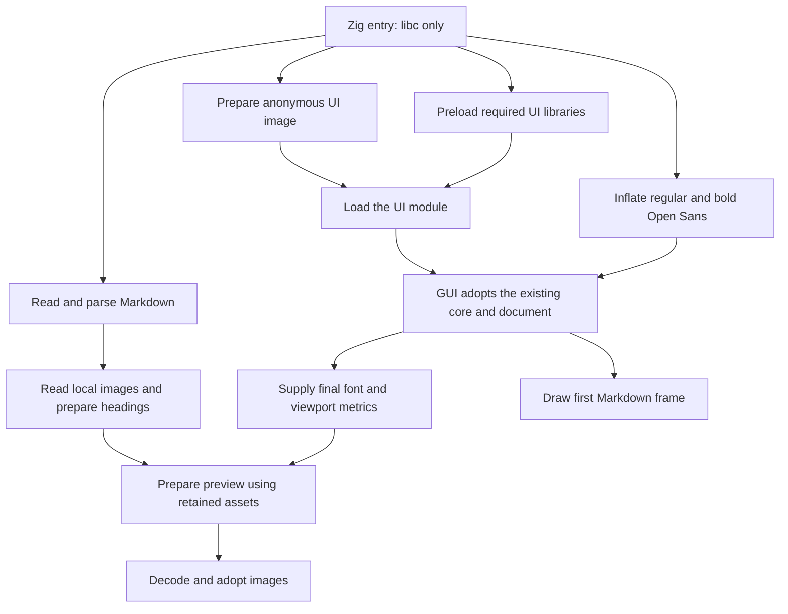

# Parallel startup

The initial executable links only libc. It contains the Zig document core, parser, settings, and font resources.
The FLTK/Cairo/Pango UI, Zig codecs, and desktop-library dependencies belong to the private UI engine.
The experimental native Zig UI uses the same bootstrap boundary through the explicit native build target.
The engine occupies the uncompressed, non-allocated `.mdf_ui` ELF section. `.mdf_ui_deps` records its `DT_NEEDED` sonames.
The kernel does not map these sections when it starts the launcher. Distribution and installation still require one executable.

The launcher validates arguments and handles `--help`, `--version`, and `--licenses` without preparing the UI.
For a document, it creates the document and persistent navigation workers first.
It starts a bundled-font worker that inflates regular and bold Open Sans with Zig's standard-library decoder.
This worker needs no UI libraries, Fontconfig, or loader calls.
It then creates both UI preparation threads behind a start barrier. Only then does it permit `dlopen` calls.
This order avoids holding the dynamic loader lock while another thread needs pthread TLS initialization.

The work overlaps as follows:

The dependency list comes from the built engine. The system loader still resolves its libraries normally, including `LD_LIBRARY_PATH`.
The library worker retains its handles for process lifetime. Function bindings remain lazy, as in the previous native executable.
Failed preloads do not conceal the UI loader's final error.
While the library worker loads the dependency graph, the UI-image worker requests read-ahead for the engine's actual dependency list.
It also hints the text stack's PCRE2, libffi, Graphite2, and libxml2 dependencies.
Bundled builds do not hint unused system Pango or Cairo files. The already loaded libc is skipped.
These advisory opens use standard x86-64 library directories. They do not load code or choose the libraries used by `dlopen`.
Missing paths are ignored. The worker stops issuing hints when dependency loading finishes.
The ordinary loader retains its search rules, including `LD_LIBRARY_PATH`.
Each timed `dlopen` includes dependencies first loaded by that call.
For example, system HarfBuzz loads FreeType and GLib, so a later FreeType row can take only microseconds.
This does not measure FreeType's independent cold-load cost.
The [glibc loader](https://raw.githubusercontent.com/bminor/glibc/master/elf/dl-open.c) serializes loading and initialization with its loader lock.
Additional `dlopen` threads cannot make that work parallel. Read-ahead, parsing, and font inflation can overlap it.
The image-preparation worker copies the raw UI ELF into a sealed executable memfd. It performs no decompression or named-file extraction.
The runtime therefore requires permission to create executable memfds for every GUI launch.
It waits for the library worker before loading the engine from `/proc/self/fd/`.

Only `mdf_frontend_api` is exported by the engine. ABI 1 checks the API version and table size before calling it.
The launcher exports the existing core C API. The engine must not link a second copy of that core.
All widget creation, FLTK startup calls, text layout, and drawing stay on the main thread after the handoff.
Library constructors run during worker loading; review their thread requirements when upgrading FLTK or desktop dependencies.

After sending the initial window requests, the main thread prepares Cairo/shared-memory buffers and visible Markdown layout while the compositor configures the window.
The driver checks the window's own state. A readable Wayland display can contain keyboard or output events and must not suppress preparation.
The normal paint reuses the prepared layout. Existing resize and scale handling invalidate it when the final geometry differs.
The first shared pool reserves the page-rounded viewport size while keeping the original backing-storage guarantee.
The main window draws directly into available shared memory. A repaint detaches to private storage if the compositor still owns that buffer.
`MDF_PREPARE_FRAME=OFF` disables this preparation for diagnostics; the default is on.

The launcher owns the core until the UI returns. The UI borrows it and consumes the pending document packet exactly once.
The wake callback changes atomically from the bootstrap eventfd to the GUI callback. Switching consumers also sends a wake notification.
The persistent navigation worker starts before UI loading, so early assets do not need another pthread creation during `dlopen`.
Its image/heading arena survives preview reflow. Window-size changes replace only the preview arena.
Reset waits for the worker to stop borrowing its document; destruction joins it before releasing storage.

Mermaid and SVG modules remain independently compressed payloads, loaded only when needed after the first committed and flushed Markdown viewport.
Optional system font discovery also keeps that gate. Moving startup earlier does not make those optional tasks block the first frame.

The profiler uses the launcher's original monotonic timestamp throughout the handoff.
It records UI-image preparation, library preloading, font inflation, their actual waits, document parsing, and asset reads in the same optimized run.
The critical path follows nested worker handoffs and chooses the later prerequisite when preview metrics join early asset preparation.
Nested calls and concurrent branches are not added to wall time twice.

`make test-launcher` checks the private ABI, libc-only dependency boundary, malformed modules, and packing.
`make test-buffers` checks shared-pixel ownership without a compositor.
`make test-gui` checks the standalone executable, rendering, fonts, and presentation gates.
`make test-packages` checks the host and every embedded module against the declared glibc requirement.
Use paired cold runs of the preserved and new binaries to judge first Markdown commit/flush and full readiness.
The [text stack guide](text-stack.md) describes bundled Pango and bounded measurement reuse.
An earlier `main` or a later empty scaffold does not establish whether document rendering improved.

For an ABI change, update `frontend/launch.h`, the launcher, and the engine together.
The build packs them atomically. To roll back a release, restore the previous complete executable; there are no separate installed engine files.
